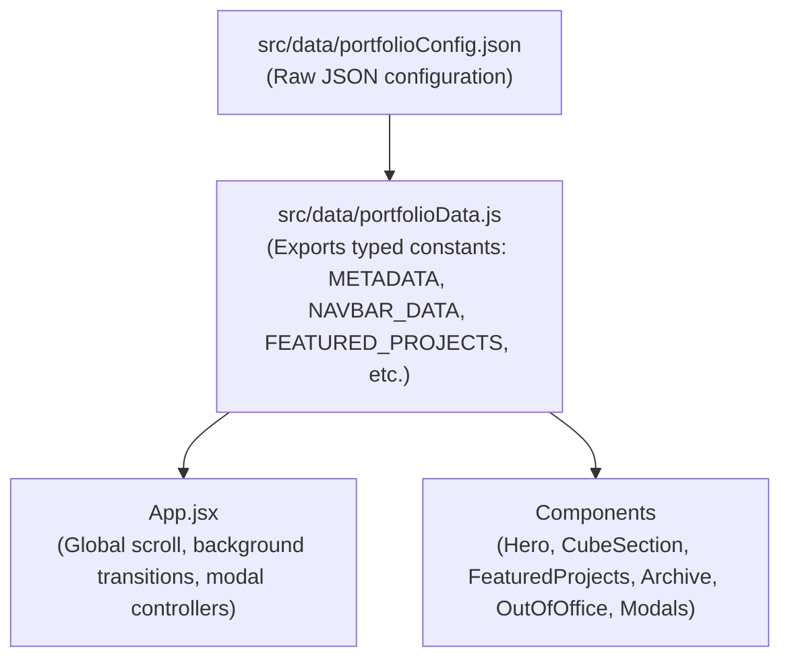

# RALFH LEO — Product Designer Portfolio

> A high-performance, immersive portfolio website built with **React 19**, **Vite 8**, **Tailwind CSS v4**, **Framer Motion 13**, **Lenis Smooth Scroll**, and custom WebGL/Canvas visual effects.

---

## 📑 Table of Contents

- [Quick Overview](#-quick-overview)
- [PART 1: Non-Developer Content Editor Guide](#-part-1-non-developer-content-editor-guide)
  - [1. The One File You Need to Know](#1-the-one-file-you-need-to-know)
  - [2. Golden Rules for Editing JSON (Don't Panic!)](#2-golden-rules-for-editing-json-dont-panic)
  - [3. Section-by-Section Editing Cheatsheet](#3-section-by-section-editing-cheatsheet)
    - [A. Personal Details & Hero Banner](#a-personal-details--hero-banner)
    - [B. Top Navigation Bar](#b-top-navigation-bar)
    - [C. About Section (Tagline, Narrative, Pillars & Metrics)](#c-about-section-tagline-narrative-pillars--metrics)
    - [D. 3D Spinning Cube Photos](#d-3d-spinning-cube-photos)
    - [E. Clients & Brand Logos](#e-clients--brand-logos)
    - [F. Featured Projects (Flagship Video Cards)](#f-featured-projects-flagship-video-cards)
    - [G. Archive / Selected Works List](#g-archive--selected-works-list)
    - [H. Out of Office / Travel Scatter Gallery](#h-out-of-office--travel-scatter-gallery)
    - [I. Resume / Curriculum Vitae Modal](#i-resume--curriculum-vitae-modal)
    - [J. Footer & Social Links](#j-footer--social-links)
    - [K. Website Title, SEO & Favicon](#k-website-title-seo--favicon)
  - [4. Adding & Updating Images and Videos](#4-adding--updating-images-and-videos)
  - [5. How to Test & Publish Changes (3 Simple Steps)](#5-how-to-test--publish-changes-3-simple-steps)
  - [6. Troubleshooting for Non-Developers](#6-troubleshooting-for-non-developers)
- [PART 2: Full Technical Documentation & Architecture](#-part-2-full-technical-documentation--architecture)
  - [1. Tech Stack & Dependencies](#1-tech-stack--dependencies)
  - [2. Directory Structure](#2-directory-structure)
  - [3. Data Flow & Configuration Architecture](#3-data-flow--configuration-architecture)
  - [4. Component Breakdown](#4-component-breakdown)
  - [5. Scroll, Animation & Canvas Architecture](#5-scroll-animation--canvas-architecture)
  - [6. Styling & Dynamic Theme Inversion](#6-styling--dynamic-theme-inversion)
  - [7. Available Commands & Scripts](#7-available-commands--scripts)
  - [8. GitHub Pages Deployment Configuration](#8-github-pages-deployment-configuration)

---

## ⚡ Quick Overview

| Attribute | Details |
| :--- | :--- |
| **Live URL** | [https://dini-sah.github.io/portfo-leo/](https://dini-sah.github.io/portfo-leo/) |
| **Framework** | React 19 + Vite 8 |
| **Styling** | Tailwind CSS v4 (`@tailwindcss/vite`) |
| **Smooth Scrolling** | Lenis v1.3 |
| **Animations** | Framer Motion 13 + GSAP 3 |
| **Content Management** | Centralized JSON (`src/data/portfolioConfig.json`) |
| **Deployment** | GitHub Pages (`gh-pages`) |

---

# 📘 PART 1: Non-Developer Content Editor Guide

This guide is designed for **non-technical editors, designers, or anyone updating content in the future**. You do **not** need to know JavaScript, CSS, or React to edit the text, images, projects, or resume on this website.

---

### 1. The One File You Need to Know

Almost all text, links, projects, and media references are stored in **one single file**:

📁 **`src/data/portfolioConfig.json`**

> 💡 **Tip:** A secondary copy also exists at `public/portfolioConfig.json`. The application compiles directly from `src/data/portfolioConfig.json`. If you edit `src/data/portfolioConfig.json`, keep both synchronized or run your build to deploy.

You can open this file using any text editor, such as:
- **VS Code** (Recommended)
- **Cursor**
- **Notepad** / **TextEdit**

---

### 2. Golden Rules for Editing JSON (Don't Panic!)

JSON files are just structured text. Follow these **4 rules** so the website builds cleanly:

1. **Always keep double quotes (`"`) around keys and text:**
   - ✅ Correct: `"name": "RALFH LEO"`
   - ❌ Wrong: `'name': 'RALFH LEO'` or `name: RALFH LEO`
2. **Every item in a list or group must have a comma (`,`) at the end, EXCEPT the last one:**
   ```json
   {
     "itemOne": "First",
     "itemTwo": "Second",
     "itemThree": "Last item has NO comma after it"
   }
   ```
3. **If your text includes a quote, use `\"` or an apostrophe (`'`):**
   - ✅ Correct: `"statement": "Hey, I'm Ralph"`
   - ✅ Correct: `"statement": "He said \"hello\""`
   - ❌ Wrong: `"statement": "He said "hello""`
4. **Line breaks:** In JSON strings, use `\n\n` to start a new paragraph:
   - Example: `"First paragraph.\n\nSecond paragraph."`

> 🛠️ **Accidentally broke the formatting?**
> Paste your JSON text into [jsonlint.com](https://jsonlint.com/) and click **Validate JSON**. It will pinpoint the exact line number with the typo.

---

### 3. Section-by-Section Editing Cheatsheet

Open `src/data/portfolioConfig.json` and locate the relevant section below:

---

#### A. Personal Details & Hero Banner
*Controls the top hero frame, copyright owner, and email handlers.*

```json
"personal": {
  "name": "RALFH LEO",
  "initials": "RL",
  "role": "PRODUCT DESIGNER",
  "experienceTag": "(Currently at RRD Design)",
  "bio": "with 2+ years of experience across automotive, SaaS and consumer platforms. Currently exploring AI powered design process in building 0 to 1 products used by thousands.",
  "year": "/PORTFOLIO '26",
  "cubeBadge": "RL·26",
  "email": "ralfhleo@gmail.com",
  "linkedin": "https://www.linkedin.com/in/ralfhleo/",
  "location": "India",
  "experienceYears": "2+ Years",
  "showreelVideo": "/placeholders/sample-video.mp4"
}
```

- **`role`**: The large headline inside the Hero card (`PRODUCT DESIGNER`).
- **`experienceTag`**: The small badge above the title, e.g. `(Currently at Acme Design)`.
- **`bio`**: The paragraph in the hero frame.
- **`year`**: The stamp in the bottom-right corner of the hero frame.
- **`email`**: The address copied to clipboard when clicking "Email" in the footer.

---

#### B. Top Navigation Bar
*Controls the logo name and header menu buttons.*

```json
"navigation": {
  "name": "RALFH LEO",
  "monogram": "RL",
  "links": [
    {
      "id": "work",
      "label": "Work",
      "type": "scroll",
      "target": "work"
    },
    {
      "id": "resume",
      "label": "Resume",
      "type": "action",
      "action": "openResume"
    }
  ]
}
```

- **`name`**: Brand text on the top left. Clicking it scrolls to top.
- **`links`**: Navigation items. `type: "scroll"` smooth-scrolls to a page section (`#work`); `type: "action"` opens the popup resume modal.

---

#### C. About Section (Tagline, Narrative, Pillars & Metrics)
*Controls the section next to the 3D cube with illuminated scrolling text.*

```json
"about": {
  "tagline": "Hey, I'm Ralph",
  "statement": "A design strategist working on digital products that turn complexity into clarity, purpose and a little more human.\n\nAligning design decisions with the business goals to drive engagement.",
  "pillars": [
    {
      "step": "01 · Systems",
      "title": "0 → 1 Architecture",
      "description": "Transforming ambiguous problem spaces into validated user flows, scalable design tokens, and production systems."
    }
  ],
  "metrics": [
    { "value": "2+", "label": "Years Experience" },
    { "value": "12+", "label": "Shipped Products" },
    { "value": "100k+", "label": "Active Users" }
  ],
  "availability": {
    "show": true,
    "text": "Available for selective advisory"
  }
}
```

- **`statement`**: The story that illuminates word-by-word as the user scrolls. Use `\n\n` for paragraph breaks.
- **`pillars`**: The three cards below the narrative. You can edit `step`, `title`, and `description`.
- **`metrics`**: The stats row (`value` and `label`).
- **`availability`**: Set `"show": false` to hide the green availability pill, or change `"text"` to update your status.

---

#### D. 3D Spinning Cube Photos
*Controls the images mapped to the faces of the sticky 3D cube.*

```json
"cubeImages": [
  { "face": "front", "src": "/placeholders/cube-1.jpg", "alt": "Project Concept 1" },
  { "face": "back",  "src": "/placeholders/cube-2.jpg", "alt": "Project Concept 2" },
  { "face": "left",  "src": "/placeholders/cube-3.jpg", "alt": "Project Concept 3" },
  { "face": "right", "src": "/placeholders/cube-4.jpg", "alt": "Project Concept 4" }
]
```

- **Dimensions:** Square images work best (e.g., `800x800px` or `1000x1000px`).
- Place new images in `public/placeholders/` and update the `src` path.

---

#### E. Clients & Brand Logos
*Controls the scrolling marquee of client brands.*

```json
"clients": {
  "tagline": "My clients & collaborations",
  "headline": "From mobility and healthcare to finance and retail, I’ve worked with teams at —",
  "logos": [
    {
      "name": "Royal Enfield",
      "src": "https://framerusercontent.com/images/MHPRyvRv1RoTaKYh7LmtCsLVa8Y.png"
    },
    {
      "name": "Hero Motocorp",
      "src": "/placeholders/my-client-logo.png"
    }
  ]
}
```

- You can use external URLs (`https://...`) or local images placed in `public/placeholders/`.
- Transparent PNG or SVG logos work best.

---

#### F. Featured Projects (Flagship Video Cards)
*Controls the large full-screen stacking project cards and their detail modal.*

```json
"featuredProjects": [
  {
    "id": "fleet-management",
    "title": "Fleet Management System",
    "year": "2025",
    "tagline": "Intelligent Telematics & Fleet Monitoring Platform",
    "video": "/placeholders/sample-video.mp4",
    "poster": "/placeholders/project-1-poster.jpg",
    "category": "Automotive SaaS",
    "client": "Global Logistics Leader",
    "role": "Lead Product Designer",
    "duration": "6 Months",
    "summary": "A unified enterprise platform delivering real-time vehicle telematics...",
    "challenge": "Dispatch managers were juggling five disparate legacy interfaces...",
    "solution": "Designed a clean, dark-mode cockpit with hierarchical information density...",
    "metrics": [
      { "label": "Fleet Vehicles Monitored", "value": "10,000+" },
      { "label": "Dispatch Response Time", "value": "-42%" }
    ],
    "features": [
      "Dynamic Route Optimization & Geofencing",
      "Predictive Maintenance AI Diagnostic Cards"
    ]
  }
]
```

- **`video`**: Path to an MP4 video (recommended format: H.264, web-optimized, muted by default).
- **`poster`**: Fallback cover image shown before the video starts playing.
- **`metrics`**: Up to 3-4 metric cards displayed inside the project modal.
- **`features`**: Bullet list of key project highlights shown in the modal.

---

#### G. Archive / Selected Works List
*Controls the interactive table with cursor-following hover preview thumbnails.*

```json
"archive": {
  "tagline": "There’s more",
  "headline": "Work work workk",
  "projects": [
    {
      "id": "puzzleyou",
      "num": "01",
      "title": "PuzzleYou - Game Design",
      "year": "2023",
      "type": "Personal Project",
      "isLive": false,
      "image": "/placeholders/archive-1.jpg",
      "description": "An engaging mobile puzzle game exploring spatial cognition...",
      "details": "Conducted research on cognitive psychology and tactile reward systems...",
      "tags": ["Mobile UI", "Game Mechanics", "Design Systems"]
    }
  ]
}
```

- **`num`**: Two-digit index number (`01`, `02`, etc.).
- **`isLive`**: Set to `true` to display the red **"LIVE"** badge next to the title.
- **`image`**: Thumbnail revealed dynamically on mouse hover (recommended: `600x380px`).
- Clicking any row opens the full case study modal with the project's `description`, `details`, and `tags`.

---

#### H. Out of Office / Travel Scatter Gallery
*Controls the 3D polaroid photo gallery that scatters outward as the user scrolls.*

```json
"outOfOffice": {
  "tagline": "Out of Office",
  "narrative": "Every few months, I take a break from work and travel...",
  "whyDesignQuestion": "Why design? My answer is simple.",
  "whyDesignAnswer": "I travel places, meet new people, observe their culture closely...",
  "scrollPrompt": "Scroll to explore",
  "photos": [
    {
      "src": "/placeholders/travel-1.jpg",
      "location": "Spiti Valley, Himalayas",
      "caption": "High altitude silence and endless horizons.",
      "targetX": 450,
      "targetY": 340,
      "targetScale": 0.38,
      "initialRotate": 3,
      "targetRotate": 8
    }
  ]
}
```

- **`photos`**: Each entry represents one polaroid photo card.
- **`location` & `caption`**: Shown when a visitor clicks a photo to open the lightbox.
- **`targetX` & `targetY`**: Pixel coordinates the card flies out to when scrolling down (positive X moves right, negative X moves left; positive Y moves down, negative Y moves up).
- **`targetRotate`**: Angle in degrees that the photo tilts at rest.

---

#### I. Resume / Curriculum Vitae Modal
*Controls the content displayed when clicking the "Resume" button.*

```json
"resume": {
  "header": {
    "title": "Curriculum Vitae",
    "name": "RALFH LEO",
    "role": "Product Designer",
    "specialization": "Digital Product Strategist",
    "location": "India",
    "email": "ralfhleo@gmail.com",
    "linkedin": "linkedin.com/in/ralfhleo",
    "linkedinUrl": "https://www.linkedin.com/in/ralfhleo/",
    "experience": "2+ Years"
  },
  "workExperience": [
    {
      "role": "Product Designer",
      "company": "Onething Design",
      "period": "2024 — Present",
      "description": "Spearheaded 0-to-1 design strategy and UI execution..."
    }
  ],
  "coreCompetencies": [
    "Product Design", "Design Strategy", "Design Systems"
  ],
  "toolsAndTech": [
    "Figma", "Framer", "React", "Tailwind CSS"
  ]
}
```

- Includes a one-click **"Print / Save as PDF"** feature in the modal header for recruiters.

---

#### J. Footer & Social Links
*Controls the bottom contact section.*

```json
"footer": {
  "tagline": "Get In Touch",
  "email": "ralfhleo@gmail.com",
  "copyHint": "Click to copy",
  "links": [
    { "id": "showreel", "label": "Showreel", "type": "action", "action": "openShowreel" },
    { "id": "resume",   "label": "Resume",   "type": "action", "action": "openResume" },
    { "id": "linkedin", "label": "LinkedIn", "type": "link",   "url": "https://www.linkedin.com/in/ralfhleo/" }
  ],
  "copyright": "© 2026 RALFH LEO. All rights reserved."
}
```

---

#### K. Website Title, SEO & Favicon
*Controls browser tab title and search engine summary.*

In `src/data/portfolioConfig.json`:
```json
"metadata": {
  "title": "RALFH LEO — Product Designer / Portfolio '26",
  "description": "Portfolio of RALFH LEO, Product Designer with 2+ years of experience across automotive, SaaS and consumer platforms."
}
```

To change the browser tab icon (favicon):
- Replace `public/favicon.svg` with your own SVG or PNG icon.

---

### 4. Adding & Updating Images and Videos

All static files are stored in the **`public/placeholders/`** folder:

```
public/
  ├── favicon.svg
  └── placeholders/
        ├── cube-1.jpg, cube-2.jpg, ... (Cube photos)
        ├── project-1-poster.jpg, ...    (Project covers)
        ├── archive-1.jpg, ...          (Archive thumbnails)
        ├── travel-1.jpg, ...           (Travel polaroids)
        └── sample-video.mp4            (Showcase video)
```

#### Steps to replace an image:
1. Save your new image in `public/placeholders/` (e.g. `my-new-project.jpg`).
2. Open `src/data/portfolioConfig.json`.
3. Change the reference to `"/placeholders/my-new-project.jpg"`.
4. Save the file.

#### Recommended File Guidelines:
| Image Type | Recommended Resolution | Recommended Format | Target File Size |
| :--- | :--- | :--- | :--- |
| **Cube Faces** | 800 x 800 px (1:1 Square) | JPG or WebP | < 150 KB |
| **Project Covers / Posters** | 1920 x 1080 px (16:9) | JPG or WebP | < 250 KB |
| **Archive Hover Thumbnails** | 600 x 380 px | JPG or WebP | < 100 KB |
| **Travel Photos** | 1200 x 900 px | JPG or WebP | < 200 KB |
| **Background / Project Video** | 1080p, H.264, Muted | MP4 | < 5 MB (compress with Handbrake) |

> 💡 **Tip:** Free tools like [squoosh.app](https://squoosh.app) can instantly compress your JPGs by 70% without visible loss in quality.

---

### 5. How to Test & Publish Changes (3 Simple Steps)

You need **Node.js** installed on your computer. Open a terminal (PowerShell, Command Prompt, or VS Code Terminal) in the project folder:

#### Step 1: Start the Local Preview Server
```bash
npm run dev
```
You will see output like:
```
  ➜  Local:   http://localhost:5173/portfo-leo/
```
Hold `Ctrl` and click the link (or paste it into Chrome/Safari). Any changes you save in `portfolioConfig.json` will **instantly update in the browser**.

#### Step 2: Verify Your Changes
Browse the site, open the modals, test buttons, and ensure no typos or missing images occur.

#### Step 3: Publish to the Live Website
When you are satisfied with your edits, run:
```bash
npm run deploy
```
This single command automatically:
1. Compiles the modern React code into production assets (`dist/`).
2. Pushes the build to the `gh-pages` branch on GitHub.
3. Within 1–2 minutes, your live site at `https://dini-sah.github.io/portfo-leo/` is updated!

---

### 6. Troubleshooting for Non-Developers

| Issue | Cause | Easy Solution |
| :--- | :--- | :--- |
| **The screen went totally blank or Vite shows an error overlay** | Missing comma, extra comma, or unclosed quote in `portfolioConfig.json`. | Check the error message for the line number. Or paste the file into [jsonlint.com](https://jsonlint.com/) to find the exact typo. |
| **My new image is not showing up (broken icon)** | Filename typo or wrong extension (e.g. `.png` instead of `.jpg`). | Verify the exact spelling and extension in `public/placeholders/`. Remember paths are case-sensitive on the web! |
| **The changes show on my computer, but not on the live link** | You forgot to run deploy. | Run `npm run deploy` in terminal and wait ~90 seconds for GitHub Pages to refresh. Refresh your browser with `Ctrl + F5` (hard refresh). |
| **`npm run dev` says command not found** | Node.js is not installed or terminal is in the wrong folder. | Make sure you are inside `C:\...\portfo-leo` and [Node.js](https://nodejs.org/) is installed. |

---

# 🛠️ PART 2: Full Technical Documentation & Architecture

This section is for **developers, maintainers, and engineers** who want to understand the codebase structure, state lifecycle, animation pipeline, and deployment settings.

---

### 1. Tech Stack & Dependencies

```
ralfh-leo-portfolio/
 ├── React 19.2.8           (UI component tree & hooks)
 ├── Vite 8.3.0             (Ultra-fast dev server & Rollup bundler)
 ├── Tailwind CSS 4.3.3     (Zero-runtime utility CSS engine with @tailwindcss/vite)
 ├── Framer Motion 13.4.6   (Declarative spring physics, scroll-linked transforms, layout animations)
 ├── GSAP 3.15.0            (High-performance tweening)
 ├── Lenis 1.3.26           (Smooth momentum scroll hijacking)
 ├── Lucide React 1.48.0    (Feather-weight SVG icon library)
 └── Canvas Confetti 1.9.4  (Celebratory particle physics)
```

---

### 2. Directory Structure

```
portfo-leo/
├── .oxlintrc.json              # Oxlint linting configuration
├── index.html                  # HTML entrypoint with Google Fonts preload
├── package.json                # Dependencies, project metadata & deployment scripts
├── vite.config.js              # Vite bundler config with base path and Tailwind plugin
├── public/                     # Static assets served as-is at runtime
│   ├── favicon.svg             # Favicon
│   ├── icons.svg               # SVG sprite sheet
│   ├── portfolioConfig.json    # Public copy of portfolio configuration
│   └── placeholders/           # Static media directory
│       ├── archive-1..5.jpg    # Archive thumbnail imagery
│       ├── cube-1..4.jpg       # 3D cube side textures
│       ├── project-1..3-poster.jpg # Video fallback posters
│       ├── travel-1..8.jpg     # Out of office travel photographs
│       └── sample-video.mp4    # Demo MP4 video for projects and showreel
└── src/
    ├── main.jsx                # Application root mounting React DOM
    ├── App.jsx                 # Top-level coordinator, global theme scroll listener & modals
    ├── App.css                 # Custom keyframe animations and label rolls
    ├── index.css               # Tailwind CSS v4 directives and typography definitions
    ├── data/
    │   ├── portfolioConfig.json # Single source of truth for all content & assets
    │   └── portfolioData.js     # Config unpacker and backward-compatible named exports
    └── components/
        ├── Navbar.jsx          # Fixed header with active spy indicator and Lenis scroll targets
        ├── Hero.jsx            # Dark glass-morphic hero frame with corner anchors
        ├── HeroCanvasBg.jsx    # Custom WebGL/Canvas silky animated shader background
        ├── CubeSection.jsx     # Scroll-linked wrapper containing Cube3D and typography reveal
        ├── Cube3D.jsx          # CSS 3D transformed cube with 4 texturized faces
        ├── ClientsScrollSection.jsx # Horizontal marquee linked to vertical scroll progress
        ├── ClientsMarquee.jsx  # Alternative continuous CSS marquee
        ├── FeaturedProjects.jsx# Sticky card deck with vertical wipe clipPath transition
        ├── ArchiveProjects.jsx # List view with spring-physics magnetic cursor hover previews
        ├── OutOfOffice.jsx     # 280vh pinned container with 3D coordinate-scattered photos
        ├── Footer.jsx          # Signature animated mail-roll button & action links
        ├── CaseStudyModal.jsx  # Rich project deep dive modal with auto-play media
        ├── ResumeModal.jsx     # Curriculum Vitae modal with window.print() PDF export
        ├── ShowreelModal.jsx   # Video showreel modal overlay
        └── Toast.jsx           # Floating clipboard copied feedback notification
```

---

### 3. Data Flow & Configuration Architecture

The application adopts a **Data-Driven Architecture**:



#### Why this design?
1. **Separation of Concerns:** Content creators do not need to touch JSX, styles, or animation logic.
2. **Deterministic UI:** Modifying an array item in `portfolioConfig.json` automatically updates layout dimensions, scroll percentages, and modal payloads.
3. **Backward Compatibility:** `src/data/portfolioData.js` spreads `portfolioConfig.personal` into `PORTFOLIO_INFO`, allowing legacy and modern property access simultaneously.

---

### 4. Component Breakdown

#### `App.jsx`
- **Global Scroll Controller:** Instantiates `Lenis` for momentum scrolling and binds it to `window.__lenis`.
- **Dynamic Theme Inversion:** Measures scroll progress across the About section (`aboutSectionRef`) with `useScroll`:
  - `bgColor`: `#000000` ➔ `#ffffff` ➔ `#000000`
  - `textColor`: `#ffffff` ➔ `#111111` ➔ `#ffffff`
  - `accentColor`: `#A670FF` ➔ `#7C3AED` ➔ `#A670FF`
  - Synchronizes `document.body.style.backgroundColor` on motion frame events.
- **Scroll Hijack Prevention:** When any modal (`selectedProject`, `isResumeOpen`, `isShowreelOpen`) opens, `lenis.stop()` is triggered and `document.body.style.overflow = 'hidden'` is enforced.

#### `HeroCanvasBg.jsx`
- Renders an interactive purple/violet fluid silk simulation on an HTML5 `<canvas>`.
- Uses sinus-wave frequency synthesis and gradient shading to simulate undulating fabric.
- Features automatic resize observation and low battery / high-DPI scaling safeguards.

#### `CubeSection.jsx` & `Cube3D.jsx`
- **Left Column:** A sticky container housing `Cube3D`.
- **CSS 3D Transforms:** `preserve-3d` container with `rotateX` and `rotateY` mapped directly to `scrollYProgress` of the section.
- **Illuminated Reveal:** The About statement text is split into paragraphs and words, where each word's opacity transitions from `0.18` to `1.0` as its relative progress window enters view.

#### `ClientsScrollSection.jsx`
- Converts standard vertical wheel scroll into horizontal translation.
- Uses `useTransform` mapped to `useSpring({ stiffness: 80, damping: 25 })` for elastic glide movement without jumpiness.

#### `FeaturedProjects.jsx`
- Implements sticky card stacking using Framer Motion's `clipPath`.
- As each subsequent project enters its scroll partition, its `clipPath` wipes from `inset(100% 0% 0% 0%)` (bottom hidden) up to `inset(0% 0% 0% 0%)` (full visibility), giving the illusion of the next card slicing over the previous one.
- Background videos utilize a subtle vertical parallax offset (`bgY`) to create depth.

#### `ArchiveProjects.jsx`
- Tabular layout displaying secondary and personal projects.
- **Magnetic Floating Thumbnail:** On `onMouseMove`, calculates mouse distance from row center and animates an absolute positioned thumbnail with a spring transition (`stiffness: 340, damping: 26`).

#### `OutOfOffice.jsx`
- **Pinned 280vh Runway:** The section stays pinned while the user scrolls.
- **Coordinate Scatter Engine:** 8 polaroid cards are initially stacked in the center. As scroll advances, each card interpolates towards its configured `(targetX, targetY)` offset with rotational tilt (`targetRotate`).
- Includes dynamic viewport width scaling factor (`spreadFactor`) ensuring cards never scatter off-screen on tablets or mobile phones.
- Clicking any card opens a high-res lightbox view.

#### Modals (`CaseStudyModal`, `ResumeModal`, `ShowreelModal`)
- Rendered via React portals and isolated from document scroll.
- Support both **Escape Key** dismissal and backdrop click dismissal.
- Tagged with `data-lenis-prevent="true"` to ensure inner modal scrolling never leaks to the parent page.

---

### 5. Scroll, Animation & Canvas Architecture

```
User Wheel / Touch Event
          │
          ▼
   Lenis (RAF Loop) ─────────► Smooth window.scrollY
          │
          ▼
  Framer Motion useScroll ────► scrollYProgress [0.0 → 1.0]
          │
    ┌─────┴───────────────────────────────┐
    ▼                                     ▼
useTransform (Interpolation)        CSS Variables & Styles
 - 3D Cube rotation (deg)            - --theme-bg
 - Clip-path wipes (inset %)         - --theme-text
 - Scatter coordinates (px)          - --theme-accent
 - Word illumination (opacity)       - --theme-border
```

---

### 6. Styling & Dynamic Theme Inversion

The project leverages **Tailwind CSS v4** via the `@tailwindcss/vite` plugin.

#### Theme CSS Variables
Dynamic colors adapt in real-time as the user scrolls:
- `--theme-bg`: Inverts background between pure black (`#000000`) and pure white (`#ffffff`).
- `--theme-text`: Inverts typography between `#ffffff` and `#111111`.
- `--theme-accent`: Shifts between vibrant lilac (`#A670FF`) and deep violet (`#7C3AED`) to maintain WCAG contrast ratios against both light and dark backgrounds.
- `--theme-border`: Transitions border opacity from `rgba(255, 255, 255, 0.1)` to `rgba(0, 0, 0, 0.1)`.

#### Typography
Imported via Google Fonts preconnect in `index.html`:
- **Unbounded:** Distinct geometric display font used for headlines, hero title, and bold branding.
- **DM Sans / Inter / Manrope:** Clean sans-serif used for body text, metrics, and modal case study reading.

---

### 7. Available Commands & Scripts

All scripts are executed via npm:

```bash
# Start local development server with Hot Module Replacement (HMR)
npm run dev

# Run Oxlint to check code quality and detect potential issues
npm run lint

# Build optimized production bundle to the dist/ directory
npm run build

# Preview the production build locally before deploying
npm run preview

# Build and automatically deploy the dist/ directory to GitHub Pages
npm run deploy
```

---

### 8. GitHub Pages Deployment Configuration

The repository is configured for automated deployment to **GitHub Pages**:

1. **`vite.config.js` Base Path:**
   ```javascript
   export default defineConfig({
     plugins: [react(), tailwindcss()],
     base: '/portfo-leo/', // Matches the GitHub repository name
   });
   ```
2. **`package.json` Homepage & Deploy Script:**
   ```json
   {
     "homepage": "https://dini-sah.github.io/portfo-leo/",
     "scripts": {
       "predeploy": "npm run build",
       "deploy": "gh-pages -d dist"
     }
   }
   ```
3. **Deployment Workflow:**
   Running `npm run deploy` triggers `predeploy` (`vite build`), generates the optimized bundles inside `dist/`, and uses `gh-pages` to force-push the `dist/` directory directly to the remote `gh-pages` branch.
4. **Custom Domain (Optional):**
   If you configure a custom domain (e.g. `ralfhleo.com`) in GitHub repository settings:
   - Change `base: '/'` in `vite.config.js`.
   - Update `"homepage": "https://ralfhleo.com"` in `package.json`.
   - Add a `CNAME` file containing your domain inside `public/CNAME`.
   - Run `npm run deploy`.

---

## 📄 License & Credits

- **Design & Concept:** Ralph Leo
- **Code & Animations:** Built with React 19, Vite, Framer Motion & Tailwind CSS v4
- **All Rights Reserved:** © 2026 RALFH LEO.
